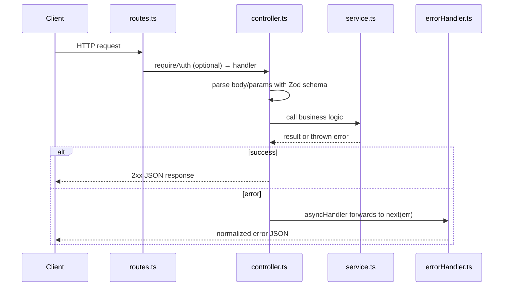
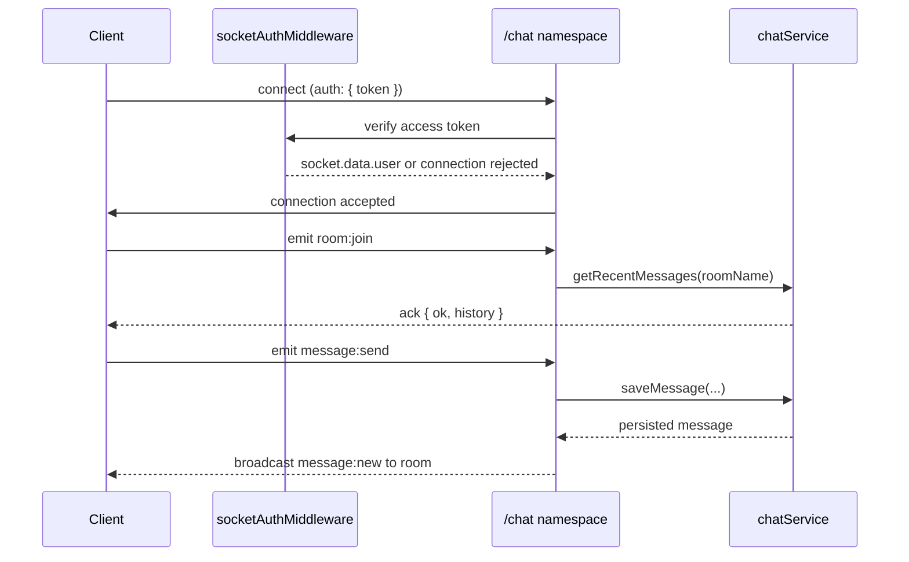

# Architecture

> [!NOTE]
> This is an *explanation* document (understanding-oriented). For
> step-by-step instructions see the [guides](../guides/), and for the
> non-obvious "why" behind specific choices see [decisions.md](decisions.md).

## Table of contents

- [Layering](#layering)
- [Why feature-based, not MVC](#why-feature-based-not-mvc)
- [Request lifecycle (REST)](#request-lifecycle-rest)
- [Connection lifecycle (WebSocket)](#connection-lifecycle-websocket)
- [Single HTTP server, one process](#single-http-server-one-process)
- [No path aliases](#no-path-aliases)

## Layering

Every module (`src/modules/auth`, `src/modules/chat`) follows the same
internal layering, regardless of transport:

```text
routes.ts / events.ts   → transport binding (HTTP routes or Socket.io events)
controller.ts            → parses input, calls the service, shapes the response
service.ts                → business logic, no Express/Socket.io types
schemas.ts                  → Zod input contracts
```

`service.ts` never imports from `express` or `socket.io`. This is what lets
`chat/service.ts` be called from both `chat/controller.ts` (REST) and
`chat/events.ts` (WebSocket) without either transport depending on the
other, and what makes the service layer testable with plain Jest — no
HTTP server or socket connection required (see `tests/chat/service.test.ts`).

## Why feature-based, not MVC

A classic `controllers/`, `models/`, `routes/` split works for CRUD REST
APIs, but breaks down once realtime events enter the picture: a
`controllers/` folder implies HTTP, so where would a Socket.io event
handler live?

Grouping by **feature** instead of by **layer** keeps every file touching
"chat" — REST and WebSocket alike — in one folder. The `events.ts` /
`routes.ts` split inside each module makes the transport boundary explicit
without spreading a feature across three top-level directories.

## Request lifecycle (REST)



1. `app.ts` wires global middleware: `helmet`, `cors`, `express.json`,
   `requestLogger`.
2. A module's `routes.ts` maps a path to a `controller` method, optionally
   behind `requireAuth`.
3. The controller parses `req.body`/`req.params` with a Zod schema, calls
   the service, and returns a response.
4. Anything thrown (a `ZodError`, an `AppError` subclass, or an unexpected
   error) is caught by `asyncHandler` and forwarded to `errorHandler`,
   which is the single place that turns errors into HTTP responses.

## Connection lifecycle (WebSocket)



1. `shared/socket/index.ts` creates one `Server` instance attached to the
   same `http.Server` Express uses, then registers each feature's
   namespace (`registerChatNamespace`).
2. `chat/events.ts` registers `socketAuthMiddleware` on the `/chat`
   namespace — it runs once per connection, not per event, since the
   client authenticates once via `io(url, { auth: { token } })`.
3. On `connection`, `registerConnectionHandlers` binds the room/message
   event handlers, each implemented as an independent function
   (`handleRoomJoin`, `handleRoomLeave`, `handleMessageSend`) so each one
   has a single reason to change.
4. Socket.io rooms scope broadcasts: joining a room via `socket.join`
   means subsequent `chatNamespace.to(roomName).emit(...)` calls only
   reach clients in that room.

## Single HTTP server, one process

Socket.io attaches to the same `http.Server` instance Express listens on,
rather than running on a separate port. This means one reverse-proxy
config and one process to deploy and monitor, at the cost of coupling the
two servers' lifecycles (acceptable for this boilerplate's scale).

## No path aliases

`tsconfig.json` intentionally has no `paths` entry (no `@/*` imports).
Plain `tsc` does not rewrite path aliases into relative `require()` calls
at build time, which is a common source of "works with `tsx`/`ts-node`,
breaks in the compiled `dist/` output" bugs. Relative imports are more
verbose but they cannot lie about what resolves at runtime.
